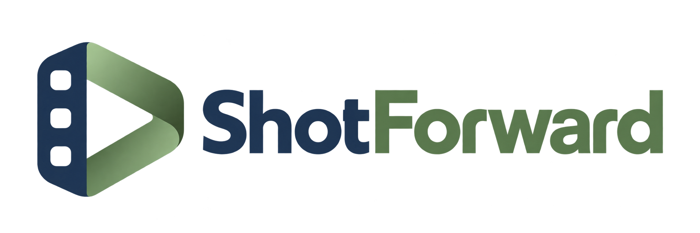
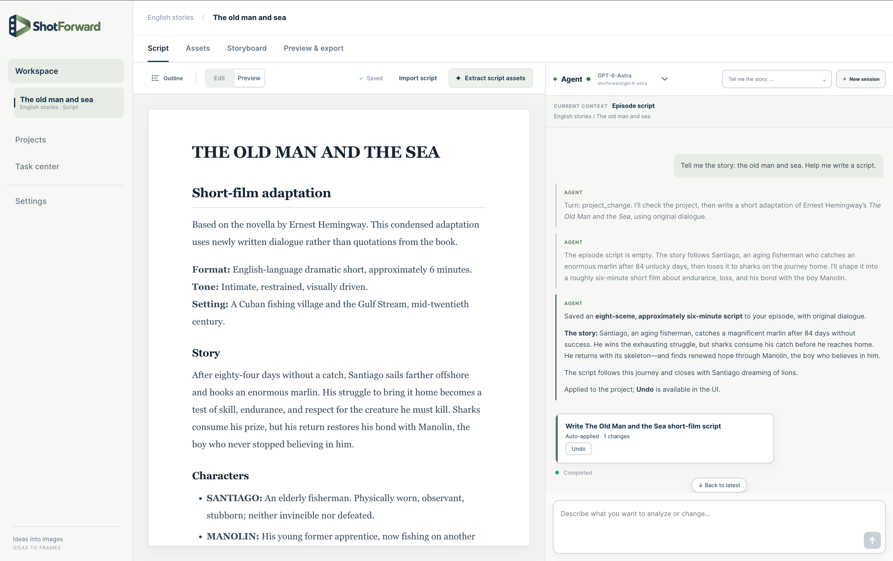
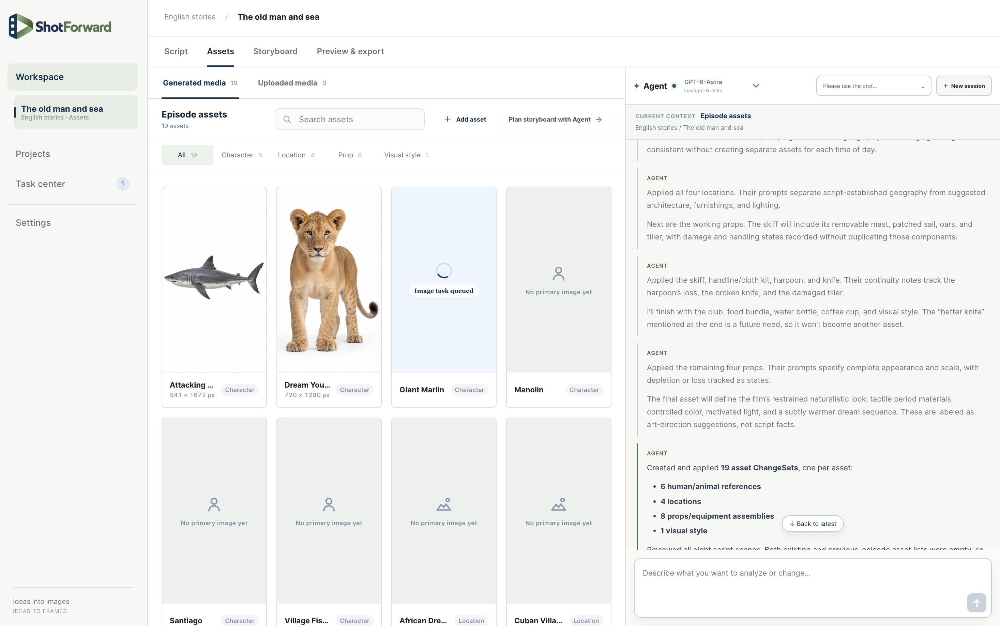
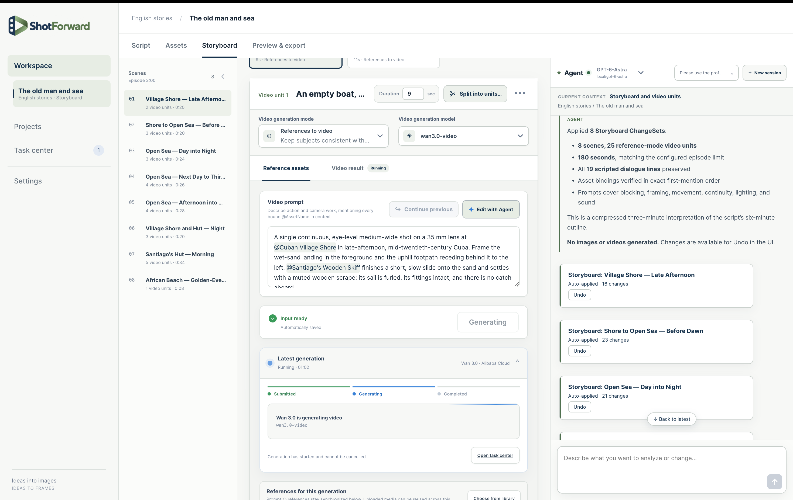
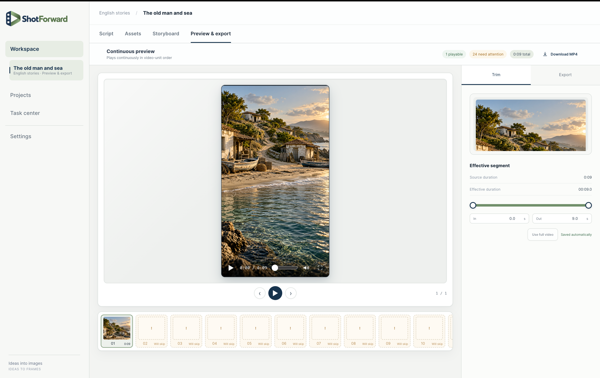

<div align="center">
  

  <h3>Ideas to frames. Stories in motion.</h3>
  <p><strong>An open-source AI video studio for filmmaking, animation, and Agent-assisted video production.</strong></p>

  <p>
    <a href="LICENSE"></a>
  </p>

  <p>
    <a href="https://shotforward.com/download"><strong>Download</strong></a>
    · <a href="#product-tour">Product tour</a>
    · <a href="#first-time-setup">Get started</a>
    · <a href="#architecture">Architecture</a>
    · <a href="#build-from-source">Build from source</a>
    · <a href="CONTRIBUTING.md">Contributing</a>
  </p>

  <p><strong>English</strong> · <a href="README.zh-CN.md">简体中文</a></p>
</div>

<br>

## From script to final delivery

ShotForward is an open-source, local-first AI video studio for short films, animation, commercials, music videos, and episodic work. Its script-to-video workflow connects scripts, character assets, storyboards, AI video generation, and MP4 export in one desktop project.

For multi-shot video production, reusable character and scene references support visual continuity across shots. Each generation can be traced back to its inputs, and Agent-authored edits remain visible project changes that can be reviewed and undone.

The result is a workflow organized around the production—not a collection of disconnected prompts.

| Stage | What stays connected |
| --- | --- |
| **Script** | Markdown authoring and import, scene navigation, and Agent-assisted revision |
| **Assets** | Reusable characters, locations, props, visual styles, and image version history |
| **Storyboard** | Scene and Clip order, shot prompts, generation modes, and bound references |
| **Generation** | Provider capabilities, persistent jobs, input snapshots, progress, and recoverable failures |
| **Preview** | Storyboard-order playback with non-destructive in/out trimming |
| **Delivery** | Background H.264/AAC MP4 export powered by FFmpeg |

## Download and install

No development environment is required to use an official desktop release. See the [official download page](https://shotforward.com/download) for available installers. The Mac Apple Silicon version is available; the Windows version is awaiting release.

| Platform | Requirements | Official installer |
| --- | --- | --- |
| **macOS · Apple Silicon** | macOS 12 or later, M-series chip | [Download](https://shotforward.com/download) |
| **Windows · x64** | Windows 10 / 11, 64-bit | Awaiting release |

Intel Macs are not supported.

The repository's community build workflows produce unsigned installers. Windows and macOS may show an unknown-developer warning for these builds; verify their accompanying SHA-256 files before installation. Third-party generation services may require a separate account, subscription, API key, or usage credits; pricing, content policies, data handling, and output rights are governed by each provider's terms.

## First-time setup

Choose how to connect your models, then follow the setup steps below.

| Connection | What you need | Configuration |
| --- | --- | --- |
| **ShotForward Cloud** | Account, credits, one-time login code | Settings → ShotForward account |
| **Local Codex** | Local sign-in and a ChatGPT subscription with the required access | Runtime settings and Agent model selection |
| **Your own video API** | Provider account, API key, endpoint, and model | Provider settings |

### Use ShotForward Cloud

1. Visit the [ShotForward website](https://shotforward.com), register an account, and sign in to the account center.
2. Recharge credits and generate a client pairing code (called a one-time login code on the website and in the client).
3. Open Settings → ShotForward account in the client and enter the pairing code before it expires to connect your account.
4. Choose a cloud Agent, image, or video model. Available models and charges are shown in the account center and client.

The cloud pairing code connects your ShotForward account. It is separate from the startup pairing code used to open the local studio when running the daemon from source.

### Use local Codex

1. Install [Codex CLI](https://github.com/openai/codex) on your machine and sign in with a ChatGPT subscription account that has the required Codex access.
2. Check local Codex status in the client's runtime settings and choose a local model in Agent. Agent and Codex image capabilities use your local sign-in; availability and limits depend on your account.

### Configure your own video API

For video generation through your own account, add a video provider in the client's Provider settings. Enter the API key, endpoint, and model for the correct region, then validate and enable the configuration.

Video services require a separate account and payment to the selected provider; a Codex subscription does not include third-party video API charges. See the [provider guide](docs/providers.md) for details. Keep pairing codes and API keys private and out of source control.

## Product tour

One project carries the production from script development and reusable visual assets through shot generation, continuous preview, and delivery.

<details>
<summary><strong>Explore the studio screenshots</strong></summary>

<table>
  <tr>
    <td></td>
  </tr>
  <tr>
    <td align="center"><sub><strong>Script</strong> · Structured writing with reviewable Agent collaboration</sub></td>
  </tr>
  <tr>
    <td></td>
  </tr>
  <tr>
    <td align="center"><sub><strong>Assets</strong> · Versioned characters, locations, props, and styles</sub></td>
  </tr>
  <tr>
    <td></td>
  </tr>
  <tr>
    <td align="center"><sub><strong>Storyboard</strong> · Shots, references, prompts, and generation results</sub></td>
  </tr>
  <tr>
    <td></td>
  </tr>
  <tr>
    <td align="center"><sub><strong>Preview &amp; export</strong> · Playback, trimming, and MP4 delivery</sub></td>
  </tr>
</table>

</details>

## Core design

### AI Agent collaboration with reviewable changes

The Agent can work with the current script, assets, and storyboard, but it cannot write around the application's rules. Persistent edits are represented as ChangeSets, validated against current project revisions, and recorded so they can be reviewed and safely undone.

### Character references and multi-shot continuity

Characters, locations, props, and styles remain reusable across shots and episodes. Image and video outputs retain version history; selecting a new current version does not destroy earlier media.

### Traceable AI image and video generation

Image, video, and export work runs as persistent jobs with frozen input snapshots, progress, stable failure categories, and retry context. Results enter the project only after media validation, preserving the relationship between intent, provider, and output.

### Local-first video production, flexible providers

Project databases and media live in the directory you choose. The local daemon binds only to the loopback interface, and credentials are kept in operating-system secure storage rather than project files. Requests to third-party generation services send the required inputs to the provider you configure and remain subject to that provider's terms.

## Integrations

ShotForward keeps project data independent from any single model vendor. The current codebase includes these adapters:

| Capability | Current adapters |
| --- | --- |
| **Studio Agent** | Local Codex, ShotForward Runtime |
| **Image generation** | Codex subscription-backed image capability |
| **Video generation** | Seedance, MiniMax H3, Wan |
| **Media processing** | FFmpeg and ffprobe |

Actual availability depends on the installed ShotForward version, provider account, region, and service status. The studio exposes only capabilities confirmed by the local daemon.

## Architecture

```text
ShotForward Desktop (Tauri)
          │
          │ localhost + protected session
          ▼
React Web UI ───────────► shotforwardd
                              ├── Application / Domain
                              ├── SQLite + project media
                              ├── Codex Runtime / MCP
                              ├── generation providers
                              └── FFmpeg / ffprobe
```

The architecture keeps one authoritative path for every project mutation:

- The **Tauri desktop shell** owns the window, daemon lifecycle, native dialogs, and operating-system integration.
- The **React UI** renders server state and submits commands; it does not access project databases, files, or provider credentials directly.
- **`shotforwardd`** owns domain rules, SQLite transactions, project media, background jobs, Agent sessions, and security boundaries.
- Project data and application-level settings are stored separately, making individual projects easier to move and back up.

The daemon binds to a loopback address and uses short-lived pairing to establish a protected cookie session. Write requests are checked for both Origin and CSRF protections. See the [architecture overview](docs/architecture.md) and [provider guide](docs/providers.md) for the full boundary model.

## Build from source

### Requirements

- Go `1.26`
- Node.js `22.21.1`
- Rust `1.85+` for the desktop shell
- FFmpeg and ffprobe for media processing and export
- Codex CLI, installed and signed in, when using the local Agent or subscription-backed image capability

Run commands from a clean checkout of the repository. Platform-specific desktop packaging also requires the standard Tauri prerequisites for Windows or macOS.

### Build the Web UI

```sh
cd web
npm ci
npm test
npm run build
```

The production bundle is written to the ignored `daemon/internal/webui/dist` build directory and embedded into the daemon binary. Build the Web UI before compiling or testing the daemon from a clean checkout.

### Run the daemon

```sh
cd daemon
go test ./...
go run ./cmd/shotforwardd
```

The daemon prints a loopback address and a temporary pairing code. Open the address in a browser and complete pairing to enter the studio.

Desktop releases bundle the Web UI, daemon, Codex Runtime, FFmpeg, and ffprobe. Stable version tags build unsigned Windows and macOS installers and publish them to GitHub Releases; maintainers should follow the [release guide](docs/RELEASING.md).

## Repository layout

```text
daemon/    Go application core, domain rules, SQLite, jobs, Agent, and local API
web/       React studio, client state, localization, and frontend tests
desktop/   Tauri shell, native integration, icons, and release tooling
docs/      Architecture, providers, release process, and screenshots
```

## Documentation

| Document | Contents |
| --- | --- |
| [Architecture overview](docs/architecture.md) | Component responsibilities, data ownership, and security boundaries |
| [Provider guide](docs/providers.md) | Generation services, credentials, and capability model |
| [Release guide](docs/RELEASING.md) | Windows and macOS builds, signing, and publishing |
| [Contributing guide](CONTRIBUTING.md) | Development environment, tests, and contribution conventions |
| [Security policy](SECURITY.md) | Vulnerability reporting and the local security model |
| [Licensing guide](LICENSING.md) | Permitted uses and commercial licensing boundaries |
| [Contributor License Agreement](CLA.md) | Terms for accepting source contributions |
| [Trademark policy](TRADEMARKS.md) | Rules for the ShotForward name, logo, and compatible products |

## Contributing

Reproducible bug reports, product feedback, and focused improvements are welcome. Please open an Issue before changing project formats, domain models, provider protocols, or security boundaries. Read [CONTRIBUTING.md](CONTRIBUTING.md) before submitting code.

## Contact

- **Website and cloud account portal**: [shotforward.com](https://shotforward.com)
- **Product and business inquiries**: [contact@shotforward.com](mailto:contact@shotforward.com)
- **Bug reports and feature requests**: [GitHub Issues](https://github.com/shotforward/shotforward/issues)

## License

ShotForward's public client source code is Open Source software licensed under the [Apache License 2.0](LICENSE). Individuals and organizations may use, study, modify, and redistribute it, including in commercial and proprietary products, subject to the license's notice and attribution requirements. Apache-2.0 does not require derivative works to publish their source code.

See the [Chinese explanation](LICENSE.zh-CN.md), [licensing guide](LICENSING.md), [Contributor License Agreement](CLA.md), and [trademark policy](TRADEMARKS.md) for details. Official hosted APIs, cloud services, accounts, credits, compute, and support are separate offerings and are not licensed by this repository's software license. ShotForward may also provide separately licensed editions and commercial arrangements; contact [contact@shotforward.com](mailto:contact@shotforward.com).

---

<div align="center">
  <sub>Built for creators who need continuity, control, and a dependable path from idea to delivery.</sub>
</div>
